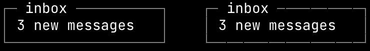
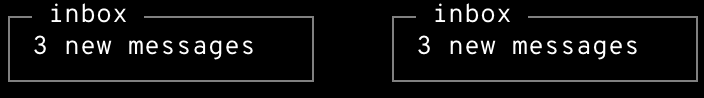
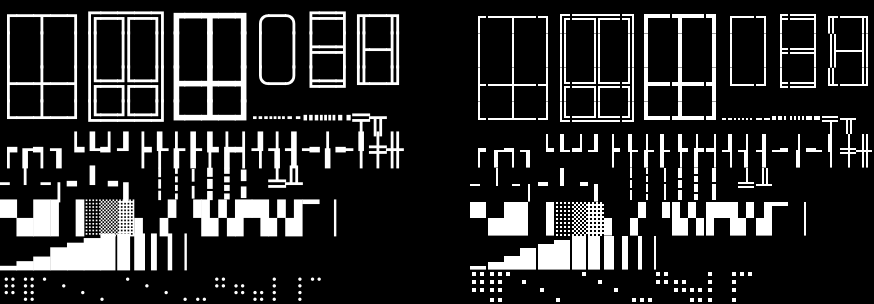
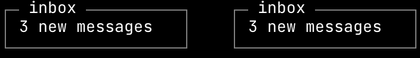
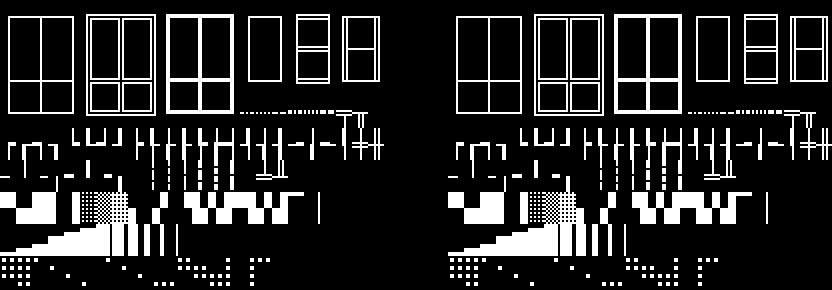

# your own font

charcell's bundled fonts are adjusted to its cell. another monospace font can
take their place once it's adjusted the same way. this guide shows why, then
takes jetbrains mono through every step.

## why a font has to be adjusted

charcell lays everything out on a grid of cells, 8 x 16 pixels at 14px, and
draws every line on its cell's center pixel. a font as it ships rarely fits
that grid, in four ways.

its characters are a fraction of a pixel off the cell. jetbrains mono's are
600 units wide on a 1000-unit em, 8.4px at 14px, so every cell after the first
starts between two pixels. the frame on the left is drawn with css and holds.
the same frame as text, on the right, with each line drawn on its cell's whole
pixels, breaks at every cell:



in the bundled font, the two are the same:



its line is its own height, rarely 16px, and its baseline can land between
two pixels, which blurs every character's bottom edge.

its box drawing, block and braille characters are drawn to look right on
their own, not to tile. they overshoot the cell, overlap their neighbors and
blur where they meet. on the left, the lines and blocks drawn on whole pixels,
the way a terminal draws them itself. on the right, jetbrains mono's own:



and on macos, a font drawn at a whole number of pixels per em has its heights
lined up with its `o`, which moves edges a fraction of a pixel at 1x.

each of these has a fix, and the rest of the guide applies them.

## jetbrains mono, step by step

these steps run in a clone of charcell, with python 3 and fonttools:

```
pip3 install fonttools brotli
```

### 1. find the units per em

a cell is 8px wide, and `size-adjust: 92.8575%` sets the 14px token at a 13px
em, so every character has to be 8 / 13 of the em wide. that ratio comes from
the units per em: a font's advance stays as it is, and its em is rescaled
around it.

read the font's advance and units per em:

```
python3 -c "
from fontTools.ttLib import TTFont
font = TTFont('JetBrainsMono[wght].ttf')
print(font['hmtx'][font.getBestCmap()[ord('0')]][0], font['head'].unitsPerEm)
"
```

jetbrains mono prints `600 1000`. the new units per em is the advance times
13 / 8: 600 x 13 / 8 = 975, the same as lilex's. the font comes out 2.6%
larger, and each of its characters is exactly 8px wide.

the result has to be a whole number. one that isn't means the font can't hold
the cell exactly.

### 2. build it

put the font beside `scripts/font/build.py` and add it to the script's `FACES`
list, with its units per em and a new name:

```python
{
    'source': HERE / 'JetBrainsMono[wght].ttf',
    'target': FONTS / 'JetBrainsMono.woff2',
    'upem': 975,
    'family': ('JetBrains Mono', 'Charcell JetBrains Mono'),
    'postscript': ('JetBrainsMono', 'CharcellJetBrainsMono'),
},
```

then run it:

```
python3 scripts/font/build.py
```

it rebuilds every font in the list and writes each to `src/styles/fonts/`.
for jetbrains mono it prints:

```
JetBrainsMono.woff2: 413 cell graphics, 256 glyphs new
  past the line: $ 0.60px, ( 0.20px, ) 0.20px, / 0.07px, [ 0.07px, \ 0.07px, ] 0.07px, { 0.07px, | 0.07px, } 0.07px, and 177 glyphs outside ascii
```

the cell graphics are the box drawing, block, shade and braille characters,
redrawn as whole-pixel shapes. 256 of the glyphs are new, because jetbrains
mono has no braille. the glyph names are gone too.

the second line lists the characters whose outlines reach past the 16px
line, and by how much. they're left as the font draws them, and checking it
shows what they do.

the italic, `JetBrainsMono-Italic[wght].ttf`, goes in the same way, under the
same name and units per em.

`'shapes': True` in an entry also draws in charcell's own ❯ and ❮, its
triangles, its bullets and its pipe, which the bundled fonts carry. that's a
matter of taste, not of the grid: jetbrains mono has all of them, and keeps
its own without it. the pipe is a 1px bar that stops a pixel short of the
line at either end, so with it on, `|` drops out of the list of characters
past the line.

### 3. declare it

an `@font-face` loads the result with the size and line from the bundled
fonts, and `--charcell-font-family` points charcell at it:

```css
@font-face {
  font-family: 'Charcell JetBrains Mono';
  font-style: normal;
  font-weight: 100 800;
  src: url('./fonts/JetBrainsMono.woff2') format('woff2');
  size-adjust: 92.8575%;
  ascent-override: 84.6154%;
  descent-override: 38.4615%;
  line-gap-override: 0%;
}

:root {
  --charcell-font-family: 'Charcell JetBrains Mono', ui-monospace, monospace;
}
```

`size-adjust` sets the em at 13px. the overrides make the line 16px, with 11px
above the baseline and 5px below, whatever the font's own metrics say, so the
baseline lands on a whole pixel. the italic gets a second `@font-face` with
`font-style: italic`.

the frame from before, in the adjusted font:



and its cell graphics, now the same as the whole-pixel ones:



## the requirements

a font holds the cell when it meets all five.

1. **a whole-pixel advance.** every character is exactly 8px wide at the 13px
   em `size-adjust: 92.8575%` lands the 14px token on. chromium rounds the
   adjusted size to 0.01px, so the size alone rarely gets there: the units per
   em are set so that advance / units per em = 8 / 13 (overpass mono
   1232 / 2002, lilex 600 / 975, jetbrains mono 600 / 975). an advance a hair
   off drifts a long line off the grid. `build.py` sets the units per em.
2. **a 16px line, with its baseline on a whole pixel.** the line is
   `ascent-override: 84.6154%`, `descent-override: 38.4615%` (11px and 5px of
   the 13px em) and `line-gap-override: 0%`, whatever the font's own metrics
   say. the `@font-face` sets them.
3. **outlines inside the line.** a glyph that reaches past the 11px above the
   baseline or the 5px below it antialiases into the next row, which shows on
   a filled row. `build.py` lists the ones that do. a terminal clips every
   character to its cell, and a browser can't, so these are left as they are.
   ascii should stay inside. accented capitals rarely fit, the bundled fonts'
   included: their accents reach up to a pixel or two past the line, too close
   to the letter to be lowered, so `Å` can leave a faint mark on a filled row
   above it.
4. **the cell graphics drawn in.** a font's box drawing, block and braille
   characters overshoot the cell and blur where they meet, so they're redrawn
   as whole-pixel shapes, the way a terminal draws them itself. `build.py`
   draws them.
5. **no glyph names.** on macos, coretext lines up heights near the x-height
   with the glyph named `o` when a font is drawn at a whole number of pixels
   per em, which moves edges a fraction of a pixel at 1x. a font without glyph
   names (`post` table format 3) is left alone, and nothing in the browser
   uses them. `build.py` drops them.

## checking it

charcell's tests hold every component to its text version, so they can hold a
font to the cell too. point the two `@font-face` rules in
`src/styles/base.scss` at the new files, keeping their family name, then build
and test:

```
pnpm build
pnpm test
```

two checks in the suite look at the font.

the pixel check renders each case beside its text version and compares them
pixel for pixel, at 1x and 2x, in both modes. it catches an advance or a line
that's off, and cell graphics that don't meet. the adjusted jetbrains mono
passes it.

the cell reader reads each rendered case back into text, one cell at a time,
and fails a cell that matches no character a terminal could print. it catches
what spills from one cell into the next, which the pixel check can't: the
component and its text version spill the same way. the adjusted jetbrains mono
fails it in a few cells:

```
dark tree: 2 unread, 12,2 |?/i|  14,2 |?/i|
```

each unread cell is given by its column and row, then `?` for the character
it couldn't read and the style it found. here, two cells of the selected row
in the tree, columns 12 and 14 of row 2. the row below is `folders [-]`, and
its brackets reach 0.07px past the line, the two listed in the build's output.
enlarged from 1x, the faint marks on the selected row's bottom edge are the
tops of `[` and `]`:

![the selected row sent above folders [-], enlarged, with faint marks on the selected row's bottom edge above each bracket](your-own-font/tree-past-the-line.png)

`pnpm text:build` writes the comparison page, `test/text/compare.html`. it
shows every case beside its text version, side by side or overlaid as a
difference, which is the quickest way to look at a failing cell.
